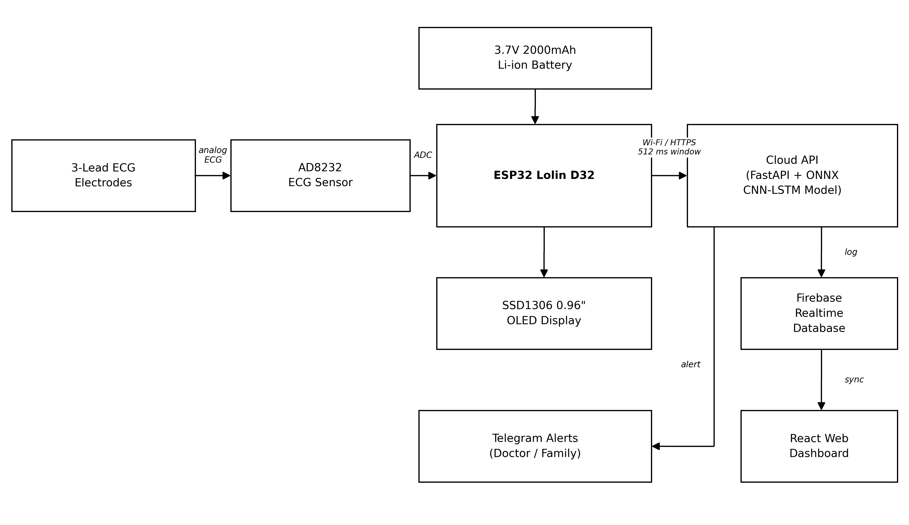

# CardioGuard AI

**A Portable ECG Arrhythmia Detection and Remote Monitoring System using a CNN-LSTM Hybrid Model**

CardioGuard AI is a wearable single-lead ECG monitor that streams cardiac signals from an ESP32 device to a cloud inference server, classifies each window with a trained CNN-LSTM model, logs every reading to Firebase, and raises automatic Telegram alerts to the patient's doctor and family when a sustained abnormal rhythm is detected.

---

## Highlights

| Metric | Result |
|---|---|
| Overall accuracy (inter-patient, held-out records) | **95.08%** |
| Test set | 16,010 windows from records unseen during training |
| Arrhythmia positive predictivity | 91.01% (false-positive rate 0.48%) |
| At-Risk positive predictivity | 100.00% |
| Average inference latency | 0.76 ms |
| Validation standard | ANSI/AAMI EC57 |

Accuracy is reported under an **inter-patient (by-record) split** — no patient contributes windows to more than one of the training, validation, and test sets — so the figure reflects performance on genuinely unseen patients rather than unseen beats from known patients.

---

## System Architecture



```
3-Lead Electrodes → AD8232 → ESP32 Lolin D32 ──Wi-Fi/HTTPS──▶ FastAPI + ONNX CNN-LSTM
                                   │                                   │
                              SSD1306 OLED                    ┌────────┴────────┐
                                                              ▼                 ▼
                                                    Firebase Realtime DB   Telegram Alerts
                                                              │
                                                              ▼
                                                     React Web Dashboard
```

The device samples at **500 Hz** and transmits **256-sample (512 ms)** windows. The server stabilises predictions with a **majority vote over the last 10 windows** and estimates heart rate from R-peaks accumulated over a rolling 5-second buffer. An alert fires only when confidence exceeds **0.85** and the per-device **300-second cooldown** has elapsed.

See [`docs/system_flowchart.png`](docs/system_flowchart.png) for the full operational flow, [`docs/cardioGuard_Schematic.pdf`](docs/cardioGuard_Schematic.pdf) for the complete hardware circuit schematic, and [`docs/cardioGuard_PCB_3D.png`](docs/cardioGuard_PCB_3D.png) for the KiCad 3D PCB layout render.

---

## Repository Layout

```
├── cloud_api.py               FastAPI inference server (/analyze, /dispatch)
├── preprocess.py              MIT-BIH → filtered, resampled 256-sample windows
├── train.py                   CNN-LSTM training (Keras)
├── export_onnx.py             best_model.keras → cardioguard_model.onnx
├── split_utils.py             inter-patient (by-record) split helpers
├── download_datasets.py       MIT-BIH downloader with retry/resume
├── add_patient_contacts.py    seeds patients + Telegram contacts in Firebase
├── install.ps1 / install.sh   automated setup script
│
├── firmware/
│   ├── cardioguard/           device 1 (patient_001) — Arduino sketch + config
│   └── cardioguard_patient2/  device 2 (patient_002)
│
├── dashboard/                 React 19 + Vite doctor dashboard
│   └── src/{components,pages,firebase.js}
│
├── ai/                        trained model, ONNX export, curves, evaluation
├── clinical_testing/          AAMI EC57 validation runner + report
├── data/                      datasets (git-ignored)
└── docs/                      manual, diagrams, pinouts, materials, PRD
```

---

## Quick Start

### 1. Run the installer

**Windows (PowerShell):**
```powershell
.\install.ps1
```

**macOS / Linux:**
```bash
bash install.sh
```

The installer creates the Python virtual environment, installs backend dependencies, generates `config.h` and `.env.local` from their templates, and installs the dashboard's npm packages. It never overwrites an existing config file.

### 2. Fill in your credentials

| File | What goes in it |
|---|---|
| `firebase_credentials.json` | Firebase service-account key (download from the console) |
| `firmware/cardioguard/config.h` | Wi-Fi SSID/password, cloud URL, patient/device IDs, Google Geolocation key |
| `dashboard/.env.local` | Firebase web config (`VITE_*` variables) |

### 3. Start the backend

```bash
uvicorn cloud_api:app --host 0.0.0.0 --port 8000
```

Check http://localhost:8000/health, then browse http://localhost:8000/docs for the interactive API reference.

### 4. Start the dashboard

```bash
cd dashboard
npm run dev
```

### 5. Flash the device

Open `firmware/cardioguard/cardioguard.ino` in Arduino IDE 2.x, select **WEMOS LOLIN32**, and upload. Watch the serial monitor at **115200 baud**.

> Full step-by-step instructions, including hardware wiring, Firebase setup, Telegram bot creation, and Railway deployment, are in **[docs/USER_MANUAL.md](docs/USER_MANUAL.md)**.

---

## Tech Stack

| Layer | Technology |
|---|---|
| Device | ESP32 Lolin D32, AD8232 ECG sensor, SSD1306 OLED, 3.7 V Li-ion |
| Firmware | Arduino C++, hardware-timer sampling, NVS fast reconnect, offline buffering |
| Backend | Python 3.12, FastAPI, ONNX Runtime, Uvicorn |
| Model | CNN-LSTM hybrid (Keras → ONNX), 3 classes: Normal / Arrhythmia / At-Risk |
| Data | MIT-BIH Arrhythmia Database, PhysioNet 2017 Challenge |
| Database | Firebase Realtime Database |
| Alerts | Telegram Bot API |
| Frontend | React 19, Vite, Recharts, Firebase Auth |
| Hosting | Railway (API), Firebase Hosting (dashboard) |

---

## AI Pipeline

```bash
python download_datasets.py     # fetch MIT-BIH records
python preprocess.py            # filter, resample 360→500 Hz, segment, label
python train.py                 # train CNN-LSTM (GPU strongly recommended)
python export_onnx.py           # export to ONNX for cloud inference
python clinical_testing/run_clinical_tests.py   # AAMI EC57 validation
```

Outputs land in `ai/` (`best_model.keras`, `history.json`, `evaluation.txt`, `plots/`) and `clinical_testing/results/`.

---

## Documentation

| Document | Contents |
|---|---|
| [docs/USER_MANUAL.md](docs/USER_MANUAL.md) | Complete installation, setup, operation, and troubleshooting guide |
| [docs/pinouts.md](docs/pinouts.md) | Wiring table and circuit diagram |
| [docs/materials.md](docs/materials.md) | Bill of materials with cost estimates |
| [docs/02-PRD.md](docs/02-PRD.md) | Product requirements |
| [docs/03-system-archi.md](docs/03-system-archi.md) | System architecture |
| [docs/04-AI-Training.md](docs/04-AI-Training.md) | Model design and training plan |
| [clinical_testing/results/clinical_test_report.md](clinical_testing/results/clinical_test_report.md) | AAMI EC57 validation report |

---

## Security Notes

These files contain secrets and are excluded from version control by [`.gitignore`](.gitignore). Never commit them:

- `firebase_credentials.json`
- `firmware/*/config.h`
- `dashboard/.env.local`

Templates (`config.h.example`, `.env.local.example`) are committed instead.

---

## Disclaimer

> **CardioGuard AI is an academic research prototype. It is not a certified medical device and must not be used for clinical diagnosis or treatment decisions.**

Single-lead ECG captures far less information than a clinical 12-lead recording, and accuracy degrades under motion artefact and poor electrode contact. Alerts depend on Wi-Fi connectivity and Telegram availability; the device buffers roughly 60 seconds of data offline, and longer outages result in data loss. Do not rely on this system as a sole means of emergency notification. Any concerning result must be confirmed by a licensed physician.

Health data handled by this system is subject to the Philippine Data Privacy Act of 2012 (R.A. 10173) and your institution's ethics approval.

---

## License

Academic thesis project. See your institution's terms for reuse.
